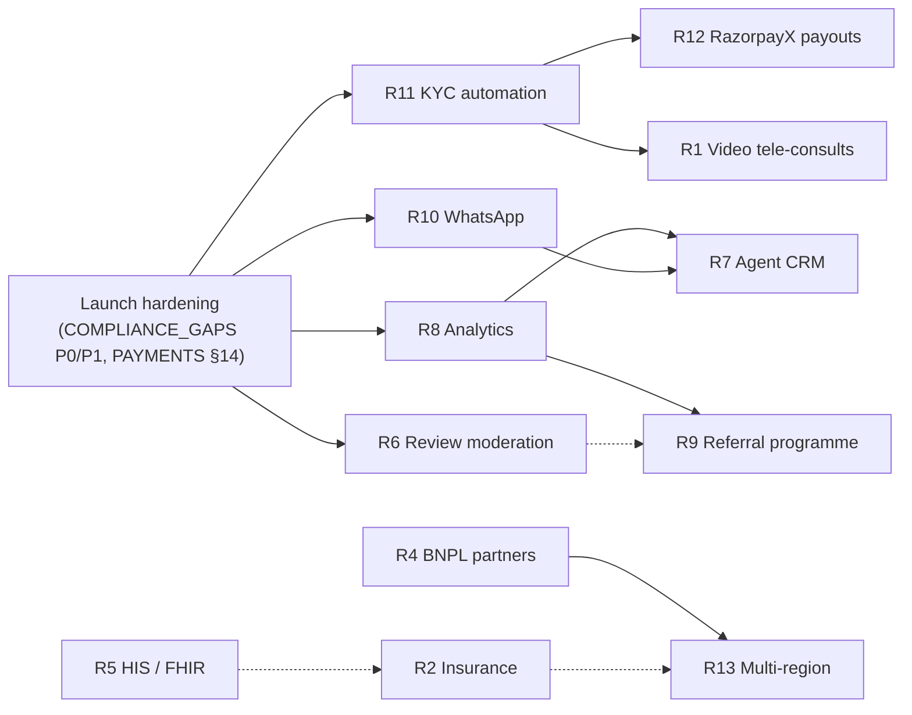

# Post-MVP product roadmap

> Owner: product-docs · Baseline: the MVP in [PLAN.md](../PLAN.md) as of 2026-10-21 · Status: a proposal for
> prioritisation, not a commitment. Regulatory statements are pointers for counsel, not legal advice.
> Related: [USER_JOURNEYS.md](USER_JOURNEYS.md) · [store compliance gaps](../store/COMPLIANCE_GAPS.md) ·
> [PAYMENTS.md](../PAYMENTS.md) · [SECURITY.md](../SECURITY.md) · [DEPLOYMENT.md](../DEPLOYMENT.md).

## 0. How to read this

Each item gives: **why** (rationale), **what exists** in PLAN, **scope**, **dependencies** (internal, external,
regulatory), **effort**, **store and privacy impact**, and **success measures**.

**Effort scale** (engineering only; partner and legal lead times are noted separately):

| Size | Meaning |
|---|---|
| **S** | ≤ 2 engineer-weeks, one module or client, no new vendor |
| **M** | 3–8 engineer-weeks across 2–3 modules or clients, at most one new vendor |
| **L** | > 8 engineer-weeks, and/or an external partner, regulator or new legal entity on the critical path |

**Before any of this: launch hardening.** The P0 and P1 items in
[COMPLIANCE_GAPS.md](../store/COMPLIANCE_GAPS.md) come first: account deletion, Sign in with Apple, honest claims,
AI consent, agent consent, push notifications and so on. So do the payments open items in PAYMENTS.md §14 (installment
confirmation conflict, consultation-fee recognition, chargebacks, payout reversals) and the open findings in
SECURITY.md §20. Several roadmap items assume those are closed.

**Baseline changes since this roadmap was first drafted (2026-10-21):**
- **One mobile app for patients, agents and hospital users** (PLAN §3.1), with role-based sections after a single
  login; staff remain web-only. Partner-facing items (R1 doctor side, R5, R7, R11, R12) therefore need a mobile
  decision as well as a web one: build in both, or keep the feature web-only and link to it from the app. Every
  mobile change for any role goes through the store privacy-form gate (CG-12, CG-32).
- **English only** (product decision): app, portals, listings, notifications and voice intake. R3 is unscheduled.

## 1. Summary

| ID | Item | Effort | Horizon | Key dependencies | Main value |
|---|---|---|---|---|---|
| R1 | Video tele-consults | **L** | Next | consultations model, consult-fee settlement (PAYMENTS §14 #4), video vendor, telemedicine law, R11 (doctor verification) | Pre-travel trust, follow-up care, revenue |
| R2 | Insurance integrations | **L** | Later | Insurer/TPA partners, IRDAI-compliant distribution, ledger insurer accounts, R5 helps | Removes the cash barrier |
| R3 | More languages (product is English only) | — | **Unscheduled** | Only if the English-only decision is revisited | — |
| R4 | BNPL partners | **M** per partner (+ long commercial lead) | Later | Merchant entity per market, PA/FEMA model, partner underwriting | Affordability, larger bookings |
| R5 | Hospital HIS/PMS integration (HL7 FHIR) | **L** | Later (pilot in Next) | Hospital agreements, integration module, FHIR/HL7 tooling | Less re-keying, real availability, automatic admit/discharge |
| R6 | Review moderation | **M** | Now | Reviews model, report endpoint (CG-16), review-law compliance | Trust and conversion |
| R7 | Agent CRM | **M** | Next | Agent consent (CG-14), R8, R10 | Agent productivity and retention |
| R8 | Analytics | **M** | Now | Warehouse, event taxonomy, consent, store disclosures | Decisions, SLAs, AI quality |
| R9 | Referral programme | **M** | Next | Ledger credits, fraud controls, store incentive rules | Low-cost acquisition |
| R10 | WhatsApp Business notifications | **M** | Now | Opt-in consent kind, BSP, phone verification | Reach in WhatsApp-first markets |
| R11 | KYC automation | **M** | Now | KYC/KYB vendors, bank validation | Faster, safer onboarding; payout quality |
| R12 | Automated payouts (RazorpayX) | **M** | Now (after the PA-model decision) | PAYMENTS §13.1 decision, R11, finance ops | Payout speed and accuracy |
| R13 | Multi-region expansion | **L** per wave | Later | R4, regional payment providers, data residency, legal entities | Growth |

## 2. Sequencing

- **Now** (0–3 months after launch): R11 KYC automation → R12 RazorpayX payouts; R10 WhatsApp; R6 review
  moderation; R8 analytics foundation. These are operational efficiency, compliance, trust and channel items; each is
  M with no regulator on the critical path.
- **Next** (3–6 months): R1 video tele-consults; R7 agent
  CRM; R9 referral programme; R5 pilot with one hospital. These are growth features that rely on Now items (R7 needs
  R8 and R10; R1 needs R11 for doctor verification).
- **Later** (6–12+ months): R2 insurance; R4 BNPL; R13 multi-region; R5 broader roll-out. These depend on partners,
  legal entities or regulators.
- **Unscheduled:** R3 more languages. The product is English only (UI, listings and voice intake); R3 is kept only
  as a note in case that decision changes.

Solid arrow: needs. Dotted arrow: benefits from.

---

## 3. Items

### R1 · Video tele-consults — **L**

**Why.**
- Patients want to speak with the treating doctor before committing to travel. Quotes are estimates until the
  patient is examined (Terms §7.2), and a pre-travel consult reduces plan changes after arrival.
- Packages already promise follow-ups (`treatment_packages.includes.followup_teleconsults`), but there is no way to
  deliver them.
- Paid consults are a revenue line that already exists in the model (`PaymentPurpose.consultation_fee`).

**What exists.** `consultations` (mode `video|phone`, `meeting_url`, status, fee), `POST/GET/PATCH /consultations`,
`doctors.teleconsult_available`, and `availability_slots.slot_kind = consultation`. Today a hospital would paste an
external meeting link.

**Scope.**
1. **Booking:** slot picking from doctor availability, time-zone aware, with reminders at 24 h and 1 h.
2. **Video:** in-app video for the patient (Flutter and patient-web) and the doctor (hospital portal). Includes a
   waiting room, network-adaptive quality with audio-only fallback (`mode=phone`), an optional interpreter
   (`ServiceKind.translator`) as a third participant, and a chat side panel tied to the case conversation.
3. **Records:** doctor notes, and prescription or advice upload (`DocumentKind.prescription`). Recording is off by
   default; enabling it would need explicit consent and a retention rule.
4. **Payment and rules:** consult-fee checkout through the existing payments flow, plus the missing recognition and
   settlement for consultation fees (PAYMENTS §14 #4). Define no-show and refund rules.

**Dependencies.**
- **Internal:**
  - be-cases (consultations).
  - be-payments and be-finance (consult fees).
  - be-messaging (reminders, and new events `consultation.requested|scheduled|cancelled|completed`; see
    USER_JOURNEYS §7 G-04).
  - be-catalog (slots); hospital-portal doctor UI. Doctors may need user accounts (`doctors.user_id` exists).
  - R11, to verify the doctor's medical-council registration before a doctor can consult.
- **Vendor:** self-hosted LiveKit (open source; media stays in our India region) or a managed SDK (Daily, Vonage,
  Agora, Zoom Video SDK, 100ms). Criteria:
  - India-region media servers and TURN reachability on restrictive networks;
  - Flutter and web SDK maturity;
  - a DPA;
  - recording controls.

  The client SDK is a new dependency (`needed_dependencies`).
- **Regulatory:** India's Telemedicine Practice Guidelines (2020) govern Indian registered practitioners (consent,
  identification, documentation, prescribing limits). The **patient's country** may regulate medical practice on its
  residents (licensing), so position consults as pre-travel and second-opinion consultations, and get an opinion per
  source market. Recordings are health data.

**Store and privacy impact.**
- New camera and microphone permissions and purpose strings.
- Data safety: audio and video, "processed ephemerally" if not recorded.
- App Privacy: nothing extra if real-time only.
- Apple 3.1.3(d) allows non-IAP payment for real-time **1:1** consultations; one-to-few needs IAP, so keep calls 1:1
  with the interpreter as support.
- Google's Payments policy is silent on consultations (CG-27): confirm before charging in the Android app.

**Effort.** L: about 12 engineer-weeks (backend 3, Flutter 4, web 3, QA and ops 2), plus vendor and legal lead time.

**Success measures.** Share of quoted cases with a pre-travel consult; quote-acceptance uplift; no-show rate; call
connection within 30 s; call-quality complaints.

### R2 · Insurance integrations — **L**

**Why.** Many GCC and African patients have employer or government cover, and some international health plans cover
elective treatment abroad. A cashless guarantee of payment (GOP) removes the up-front cash barrier.

**What exists.** `bookings.insurance_claim_requested`; `patient_profiles.insurance_provider` and
`insurance_policy_number (enc)`; the `travel_insurance` checklist item; `ServiceKind.insurance`. All of it is manual
today.

**Scope (phased).**
- **A (M): claim pack.** Downloadable bundle of the itemised final invoice, discharge summary and reports for
  reimbursement claims; insurer directory; insurer details captured at booking.
- **B (L): pre-authorisation / GOP.**
  - A workflow with insurers, TPAs and assistance companies: submit the case summary and itemised quote, track
    status, record the approved amount.
  - The booking splits into an insurer-covered part and the patient co-pay.
  - Track an insurer receivable and settlement, plus what happens on claim rejection (the patient becomes liable).
- **C: travel or medical-travel insurance offer** through a licensed partner only (referral link or embedded quote).
  We neither underwrite nor advise.

**Dependencies.**
- **Internal:**
  - be-cases (covered amounts on quotes and bookings).
  - be-payments: a new payer type or `PaymentGateway` value for insurer-paid amounts (PLAN §5 enum change).
  - be-finance: ledger owner type `insurer` and account `INSURER:{id}:RECEIVABLE`.
  - documents: new `DocumentKind` values `discharge_summary`, `gop_letter`, `insurance_card`.
  - consents: new `share_with_insurer`.
  - R5 helps (final bills and discharge summaries straight from the HIS).
- **External:** insurer and TPA partnerships. Formats are mostly email and PDF, with few APIs.
- **Regulatory:** in India, soliciting or distributing insurance needs IRDAI registration (corporate agent, web
  aggregator or insurance marketing firm). Patients' countries license distribution too, so phase C goes through
  licensed partners with arrangements cleared by counsel. Data protection covers sharing with insurers.

**Store and privacy impact.** Data safety: health and financial info shared with insurers (purpose: App
functionality). Update the privacy policy recipients.

**Effort.** L (phase A alone is M).

**Success measures.** Share of bookings with insurance; GOP turnaround; cancellations caused by funding.

### R3 · More languages — **unscheduled** (possible future item; not on the roadmap)

**Product decision (2026-10-21).** Heal India Global is **English only**: app UI, web portals, store listings
(en-US, optionally en-GB with the same copy), notifications, legal documents and **voice intake** (spoken English
only, no translation). No localisation work is planned or sequenced. This entry only records what it would take if
the decision is revisited, so nobody has to rediscover it.

**If it is ever revisited, expect:**
- string extraction (Flutter gen-l10n, i18next on the web), locale formats, and RTL layout work for any
  right-to-left language (the body map must never mirror);
- translated catalog content (a schema change), notification and e-mail templates, receipts with Unicode fonts;
- legally reviewed translations of the Terms, Privacy Policy and consents (consent must be informed in a language
  the patient understands);
- voice intake beyond English (multilingual speech-to-text and a reviewed translation step) and AI output in other
  languages, with disclaimers always from reviewed copy, never from model output;
- localised store listings, keywords and screenshots;
- coordinators who speak each language.

**Effort if revisited.** M for the framework plus a first language, S–M per further language; more for a
right-to-left language.

**Until then.** Non-English-speaking patients are served through agents and the in-country translator service
(`ServiceKind.translator`), which are real-world services, not app localisation.

### R4 · BNPL partners — **M** engineering per partner; commercial and legal lead time dominates

**Why.** Treatments cost thousands to tens of thousands of USD. PLAN's own instalments leave the collection risk
with hospitals (PAYMENTS §10.1). Licensed BNPL or medical-finance partners take on the credit risk and allow longer
tenors. The payment design already shows "Payment plans … with Affirm", which is not integrated (CG-17).

**Options by market** (illustrative; check eligibility and medical-category acceptance):
- **US:** Affirm/Klarna-type, generally needing a US merchant entity and settlement account.
- **GCC:** Tabby/Tamara-type, needing GCC merchant presence.
- **UK and EU:** Klarna-type.
- **Africa and South Asia:** local medical lenders and bank EMI partners.
- **India-resident NRIs paying in INR:** Razorpay cardless EMI and pay-later (Indian customers only).

**Scope.**
- A generic BNPL gateway adapter in `payments/gateways/`, adding new `PaymentGateway` values (PLAN §5 change).
- Hosted or redirect checkout.
- Webhook signature verification and idempotency, under the same contract as PLAN §9.4.
- Reconciliation of partner settlements net of fees; refunds through the partner API.
- Ledger accounts `GATEWAY:{partner}:RECEIVABLE` and a fee expense.
- Partner-provided eligibility messaging: no "pre-approved" or "0% for everyone" claims.

**Dependencies.**
- A merchant entity in the partner's market (ties to R13).
- FEMA export-of-services proceeds (PAYMENTS §13.2).
- The payment-aggregator model decision (PAYMENTS §13.1).
- Partner underwriting.
- Consumer-credit law in each patient's country.
- The Google Play Financial features declaration update (CG-18).
- Store copy review.

**Effort.** M per partner (about 4–6 engineer-weeks after contracts).

**Success measures.** BNPL share of bookings; average booking value; cancellations for affordability.

### R5 · Hospital HIS/PMS integration (HL7 FHIR) — **L**

**Why.** Hospitals re-key availability, admissions, discharges and bills into the portal, which brings delays,
errors and stale availability. Integration enables:
- real slots;
- automatic admit and complete;
- discharge summaries for patients and insurers (R2);
- final bills to reconcile against quotes.

**Scope.**
- A new `integrations` backend module (PLAN change) with per-hospital connector configuration and mapping tables.
- **FHIR R4 mappings:**

  | FHIR resource | Maps to |
  |---|---|
  | Practitioner / PractitionerRole | `doctors` |
  | Schedule / Slot | `availability_slots` |
  | Appointment | Consultations and admission slots |
  | Encounter (in-progress / finished) | Booking admitted / completed, applied through the same service logic as `POST /bookings/{id}/admit|complete`, with audit |
  | DocumentReference / Composition | `documents` (discharge summary, reports) |
  | ChargeItem / Invoice | Final bill vs quote |
  | ServiceRequest (outbound referral) | Consented DocumentReferences sent with it |

- **India:** ABDM's FHIR R4 profiles (NRCeS) are increasingly supported by Indian HIS vendors. Don't depend on ABHA
  IDs, which foreign patients generally don't have.
- **Legacy systems:** many HIS have no FHIR API. Support HL7 v2 (ADT A01/A03, SIU) through an interface engine, or
  SFTP/CSV as a fallback.
- **Security:** SMART Backend Services or OAuth2 client credentials, mTLS, IP allowlists, signed callbacks,
  idempotency, audit, PHI minimisation.

**Dependencies.** Hospital agreements and DPAs (data flowing back to us); the be-cases state machine (automatic
transitions must respect PLAN §5); be-catalog mappings; documents; FHIR model library (`needed_dependencies`);
security review; a test environment per hospital.

**Store and privacy impact.** None in the app beyond new document kinds. Privacy policy: data received from
hospitals.

**Effort.** L for the platform plus a first pilot hospital (about 12–16 engineer-weeks), then M per additional HIS
vendor.

**Success measures.** Share of bookings with automatic admit and discharge; quote turnaround; data-entry hours
saved.

### R6 · Review moderation — **M**

**Why.** The `reviews` table (`pending|published|hidden`) and rating aggregates exist, and `HospitalDetail` embeds
reviews. But there is no submission API and no moderation UI. Verified reviews drive trust, and review fraud or
suppression is legally exposed.

**Scope.**
- **Patients:**
  - `POST /reviews`, allowed only after the booking is `completed`, one per booking, with a "Verified patient"
    badge.
  - An edit window; delete your own; reviews are deleted on account deletion (Apple names reviews).
- **Moderation:**
  - An admin queue with approve or hide and reason codes.
  - Content-based rules only: personal data, abuse, medical misinformation, off-topic. **Never hide for negative
    sentiment.**
  - AI-assisted pre-screening (a small Claude model) flags personal data and abuse for a human decision, with an
    audit trail.
- **Hospitals:** a public right of reply. Reporting runs through the CG-16 `POST /reports`.
- **Aggregates:** a job recalculates `rating_avg` and `rating_count`.
- **Transparency:** publish the moderation policy.
- **Doctor ratings:** decide whether to show them. India's medical-ethics rules bar doctors from soliciting
  patients, so never offer incentives for reviews.

**Legal context.**
- US FTC rule on consumer reviews and testimonials (2024): bans fake reviews and review suppression.
- UK DMCC Act: bans fake reviews.
- India: CCPA guidance and BIS IS 19000:2022 on online consumer reviews.
- Apple 1.2 and Google's UGC policy: reporting and moderation.

**Dependencies.** be-catalog (model and aggregates); be-cases (eligibility); be-admin and web-admin-ops (queue);
be-messaging (tell the hospital); web-hospital (reply); fl-journey and web-patient (submit); legal (policy,
takedown process); CG-16; CG-01.

**Store and privacy impact.** Data safety: other user-generated content, shared publicly. App Privacy: Other User
Content.

**Effort.** M (about 5–7 engineer-weeks).

**Success measures.** Reviews per completed booking; moderation SLA; hide rate with reasons.

### R7 · Agent CRM — **M**

**Why.** Facilitators in source markets bring much of the volume, and the agent portal is transactional
(PLAN §10). CRM tooling raises agent throughput and retention.

**Scope.**
- A pipeline board (lead → screening → quotes → booked → travelled → completed) built on cases and screenings.
- Tasks and reminders; private notes per patient (agent-only; PHI handling).
- An activity timeline from `case_status_history`.
- CSV bulk import that sends consent invitations (CG-14).
- A shareable quote comparison: an expiring signed link, with patient consent and no PHI in the URL.
- WhatsApp click-to-chat (R10).
- **Agency teams:** a new `agent_members` table mirroring `hospital_members`.
- A commission forecast from pending and eligible settlement items.
- Tier automation (bronze/silver/gold) driven by volume through agent-scope `commission_rules`.
- Agent performance analytics (R8).

**Dependencies.** be-messaging (agents module); be-cases; be-screening; be-finance; consent model (`share_with_agent`,
CG-14); R8; R10; backend-models (members, notes, tasks); web-agent.

**Store and privacy impact.** Agents now use the mobile app too (agent section, PLAN §3.1). If CRM notes, tasks or
reminders reach the app, update both privacy forms (agent-entered notes about patients are Health or Other
user-generated content) before release (CG-12, CG-32). The privacy policy must describe agent access.

**Effort.** M (about 6–8 engineer-weeks).

**Success measures.** Active agents per month; cases per agent; agent-case quote-to-booking conversion; agent churn.

### R8 · Analytics — **M**

**Why.** We need to measure the funnel, hospital SLAs, AI quality and payment health. The current
`/admin/reports/*` and dashboards are basic.

**Scope.**
- **Operational analytics:** a read replica feeding a warehouse (dbt models) and a staff BI tool (e.g. Metabase or
  Superset). Metrics:
  - the funnel: screening started → submitted → matches viewed → case → quote sent (with SLA) → accepted →
    booked → paid → admitted → completed;
  - quote turnaround per hospital; cancellations and refunds;
  - GMV and revenue by specialty and source country; agent performance;
  - AI fallback and refusal rates (`ai_request_logs`), match acceptance, emergency-flag rate;
  - payment success by method and country.
- **Product analytics:** prefer server-side events derived from the existing domain events (PLAN §6.1). If a client
  SDK is added (e.g. self-hosted PostHog):
  - exclude health data and free text;
  - honour consent through a new `analytics` consent kind;
  - no cross-app tracking, which keeps "no tracking" true and avoids an ATT prompt.
- **Governance:** pseudonymous ids in the warehouse, role-based access, retention per DEPLOYMENT §13, and an updated
  DPIA.

**Dependencies.** Infra (replica, warehouse); an event-taxonomy document; the consent model; `backend/evals` (AI
quality).

**Store and privacy impact.**
- **Client SDK:** Data safety needs App interactions with the Analytics purpose, and App Privacy needs Product
  Interaction with the Analytics purpose, before release (CG-12 gate).
- **Server-side only:** no new data types, but add the Analytics purpose to the types analysed.

**Effort.** M.

**Success measures.** A weekly metrics review is running; hospital SLA dashboards are in use; AI quality regressions
are caught before release.

### R9 · Referral programme — **M**

**Why.** Medical travel runs on trust, and word of mouth from treated patients is the cheapest acquisition. Agent
referral exists (`agent_code`); patient-to-patient referral doesn't.

**Scope.**
- Patient referral codes and deep links in their own namespace. Today `referral_code` at registration means an
  agent code; add a type prefix.
- **Reward only when the referred patient completes treatment** (`booking.completed`), never on install or sign-up.
- **Reward form:** a credit against the platform service fee (`patient_service_fee_bps`) or a travel perk such as a
  free airport pickup. It is **not** a discount on hospital medical fees, which avoids inducement and fee-splitting
  concerns and keeps hospital pricing clean.
- Fraud controls: self-referral checks (device, payment instrument, hashed passport) and caps.
- Ledger: marketing expense and credit-liability accounts; `bookings.discount_minor`.
- Tax treatment of rewards; programme terms.

**Store rules.** Google Play's Ratings, Reviews and Installs policy forbids incentivised installs and reviews, and
Apple bans rewards for ratings or for downloading other apps. Completion-based rewards avoid both. Use the system
share sheet, not the contacts permission.

**Dependencies.** be-auth (codes); be-cases (completion trigger); be-payments and be-finance (credits, ledger); R8
(attribution); R6 (referrers who also review must disclose the connection); legal.

**Effort.** M (about 4–6 engineer-weeks).

**Success measures.** Referred share of bookings; reward cost vs acquisition cost; fraud rate.

### R10 · WhatsApp Business notifications — **M**

**Why.** WhatsApp is the primary messaging channel in most source markets (Africa, the Middle East, South Asia) and
reaches people better than email. `patient_profiles.whatsapp` exists, and helplines already include WhatsApp.

**Scope.**
- The WhatsApp Business Platform (Cloud API) directly or through a provider (e.g. Gupshup, Twilio, Infobip,
  360dialog). Meta business verification of our entity.
- **Opt-in:** a separate, explicit consent through a new `ConsentKind` value, e.g. `whatsapp_updates` (PLAN §5
  change). Opt-out with "STOP" and an in-app toggle.
- **Utility templates:** quote ready, booking confirmed, payment received, appointment reminder, pickup and visa
  reminders, SOS acknowledgement. Generic text plus a deep link, **never medical details** (DEPLOYMENT §12; the same
  principle as Apple 4.5.4). Example: "Your booking HIG-B-2026-000123 is confirmed. Open the app for details."
- **Channel routing** in be-messaging (in-app, email, push, WhatsApp) with per-user preferences, quiet hours by time
  zone, and deduplication.
- Delivery-status webhooks (signature-verified), with email or push fallback.
- **Phase 2:** inbound messages routed into the case conversation; 24-hour service-window handling.
- **Costs:** Meta charges per template message by category and country. Budget and monitor.

**Dependencies.** be-messaging (channel abstraction, templates); jobs; consent model; **phone verification**, which
PLAN lacks (add an OTP endpoint, E.164 numbers); legal (DPDP/GDPR, local messaging rules).

**Store and privacy impact.** Data safety: phone number gains the Developer communications purpose. Privacy policy:
WhatsApp provider as a processor.

**Effort.** M (about 4–6 engineer-weeks for one-way; another M for two-way).

**Success measures.** Delivery and read rates; no-show reduction; opt-out rate.

### R11 · KYC automation — **M**

**Why.** Hospital and agent onboarding is document upload plus manual admin review (PLAN §8.5, §8.10, §8.13). That
is slow and fraud-prone. Payouts need validated bank accounts, TDS needs a valid PAN (PAYMENTS §13.4), and doctors
should be verified before tele-consults (R1).

**Scope.**
- **Indian entities:** PAN verification; GSTIN validation; company or LLP registry lookup; bank-account validation
  by penny drop or fund-account validation (RazorpayX, which fits R12); name matching across documents.
- **Doctors:** medical-council registration checks (the NMC Indian Medical Register and state councils),
  manual-assisted where there is no API.
- **Accreditations:** JCI and NABH status from public directories, with expiry tracking. `hospitals.accreditations`
  should only come from verified records, which supports honest claims (CG-03, CG-19).
- **Foreign agents:** KYB checks (business registries); sanctions and PEP screening (UN/OFAC/EU/UK) at onboarding
  and periodically; principal ID document with liveness.
- **Patients (optional):** on-device passport MRZ scan to fill passport fields and cut visa errors. The image is not
  uploaded unless the user chooses to upload the passport.
- Risk scoring and a manual-review queue in admin. The existing approve and reject actions stay the decision point.

**Vendors.** Indian KYC/KYB APIs (evaluate e.g. IDfy, Signzy, Perfios, Digio) and a global KYB and sanctions
provider. Data residency in India; DPAs. Avoid Aadhaar-based eKYC, whose use is restricted.

**Dependencies.** be-admin (approvals); documents (`kyc_*` kinds exist); be-finance (`payout_accounts.is_verified`);
R12; legal (retention of verification data).

**Store and privacy impact.** Only for passport scanning: camera use with on-device processing, so no new
collected type if images stay local.

**Effort.** M (about 5–7 engineer-weeks plus vendor onboarding).

**Success measures.** Submit-to-approval time; fraud incidents; payout failures caused by bad bank details.

### R12 · Automated payouts (RazorpayX) — **M**

**Why.** PLAN pays through `razorpay_route` (linked accounts) or `manual_bank_transfer`, where finance types in the
UTR. Manual payouts are slow and error-prone at volume. `PayoutMethod.razorpayx` already exists in the enum.

**Scope.**
- A RazorpayX current account.
- Contacts and fund accounts created from verified `payout_accounts` (fund-account validation, R11).
- The Payouts API with the idempotency key set to the payout id.
- Webhooks for processed, reversed and failed payouts mapped to `PayoutStatus`. Add the missing reversal posting
  (PAYMENTS §14 #8).
- **Maker-checker stays:** a different finance user approves the batch before `process`.
- Balance checks and low-balance alerts; statement import; automatic UTR capture; retries with backoff.
- TDS on agent commission before payout (PAYMENTS §13.4 gap); payout-advice emails.

**Constraint.** RazorpayX and Route are domestic INR only. Payouts to non-resident agents stay manual over SWIFT,
with Form 15CA/15CB and withholding analysis (PAYMENTS §13.3).

**Dependencies.**
- The payment-aggregator and escrow decision (PAYMENTS §13.1): if Route-based holds are chosen, hospital payouts may
  become Route transfers instead.
- be-finance (settlements, ledger); be-payments webhook patterns; R11.
- Finance operations and treasury (funding the current account); auditors.

**Effort.** M (about 4–6 engineer-weeks).

**Success measures.** Payout cycle time; share automated; failure and reversal rate; finance hours saved.

### R13 · Multi-region expansion — **L** per wave

**Why.** Growing beyond the first source markets takes local payment methods, partners and compliance. The product
stays English only, so new markets are chosen and served on that basis (English-speaking patients, or patients
working through an agent).
Adding destination countries other than India would be a strategic pivot, scoped separately below.

**Scope (launch kit per new source market).**
- **Payments:**
  - local methods through regional providers, e.g. M-Pesa (Kenya), bKash (Bangladesh), mada (Saudi Arabia);
  - local-currency pricing (`supported_currencies` exists);
  - a merchant of record where the provider requires one (ties to R4).
- **Data protection and residency.** Decide per market whether to keep data regional, transfer on consent, or not
  launch. Examples:
  - GDPR, with an EU representative; UK GDPR;
  - UAE PDPL and the UAE health-data rules, which restrict storing or processing health data outside the UAE
    except where permitted;
  - Saudi PDPL transfer rules;
  - Nigeria NDPA 2023;
  - Kenya DPA 2019 (controller registration).
- **Other legal:** consumer, advertising and medical-advertising law in each market.
- **Operations:** local agents and offices; support hours across time zones; embassy and airport partners; e-Medical
  visa eligibility by nationality.
- **Product:** store availability per country (English listings only); regional pages on the website (English).
- **Infrastructure:** CDN and edge presence near source markets; WebSocket latency; a status page.
- **Multi-destination (only if strategy changes):** `hospitals.country` defaults to `IN`, and the ledger is INR-based
  with Indian tax accounts (GST, TDS). Other destinations would need per-entity ledgers and tax handling, a separate
  L+ refactor.

**Dependencies.** R4, R2, R10, legal entities, finance (FX, tax), security (residency), partnerships.

**Effort.** L per wave of markets.

**Success measures.** Bookings from new markets; payment success per market; zero compliance incidents.

---

## 4. Cross-cutting changes the roadmap implies (PLAN deltas to schedule)

| Area | Proposed addition | Items |
|---|---|---|
| `ConsentKind` | `share_with_agent`, `whatsapp_updates`, `share_with_insurer`, `analytics` (if client analytics) | CG-14, R10, R2, R8 |
| `PaymentGateway` | BNPL partner values; insurer-paid portion | R4, R2 |
| `DocumentKind` | `discharge_summary`, `gop_letter`, `insurance_card`, `consent_form` | R2, R5, CG-14 |
| `LedgerOwnerType` / accounts | `insurer`; referral credit liability and marketing expense | R2, R9 |
| Domain events | `consultation.*`, `review.submitted/published`, `referral.rewarded`, `kyc.*`, `payout.reversed`, integration events | R1, R6, R9, R11, R12, R5 |
| Tables | `agent_members`, agent notes and tasks, referral codes and rewards, integration connections, insurance pre-auths, KYC checks | R7, R9, R5, R2, R11 |
| Endpoints | `/reviews`, `/reports`, phone OTP verification, integration webhooks | R6, CG-16, R10, R5 |

**Every item, before release:**
1. Update the Data safety and App Privacy forms when the data or SDKs change (CG-12 gate).
2. No PHI in push, email, SMS or WhatsApp.
3. All user-facing copy is English and comes from reviewed copy, never from model output.
4. Audit-log every new state change (PLAN §9.8).
5. AI features pass `backend/evals` and keep the "not a diagnosis" framing (CG-13).

## 5. Open questions

1. **Which source markets launch first?** This drives the order of R10 and R13, and whether R4 is worth an
   early entity.
2. **The payment-aggregator and escrow model** (PAYMENTS §13.1). It decides R12's shape and affects R4.
3. **Tele-consult legality per source market** (R1). It needs counsel before scoping paid cross-border consults.
4. **The AI screening classification** in the EU and UK (CG-13). It affects R13 for those regions.
5. **Dependants** (parents booking for children): a product gap not covered by PLAN (CG-24). It needs a data-model
   decision before marketing to families.
